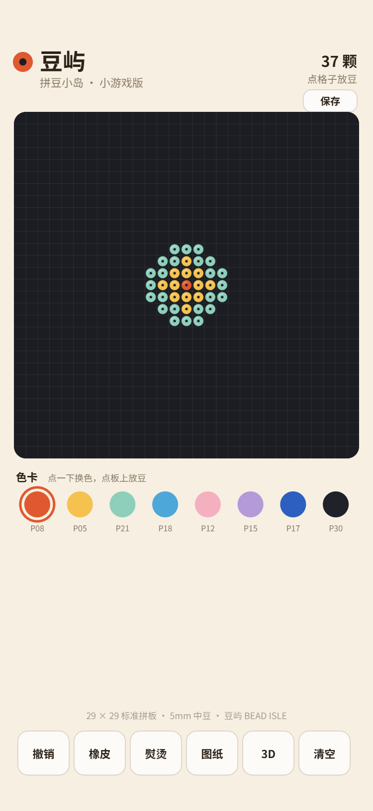
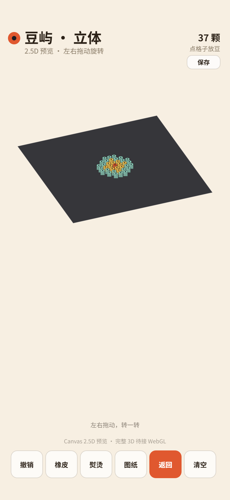
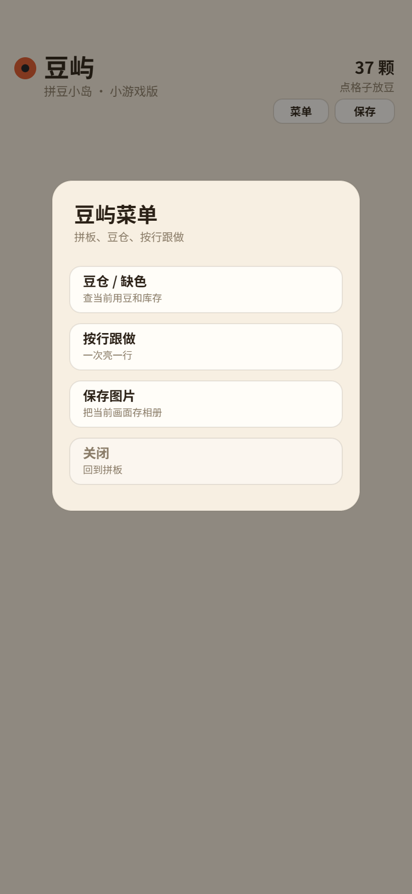
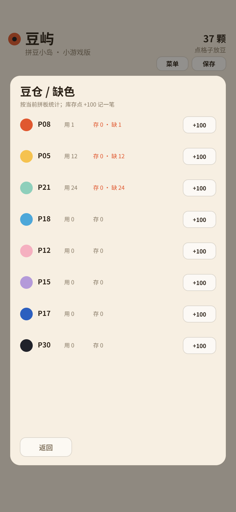
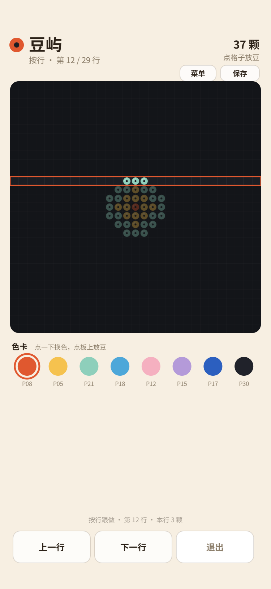
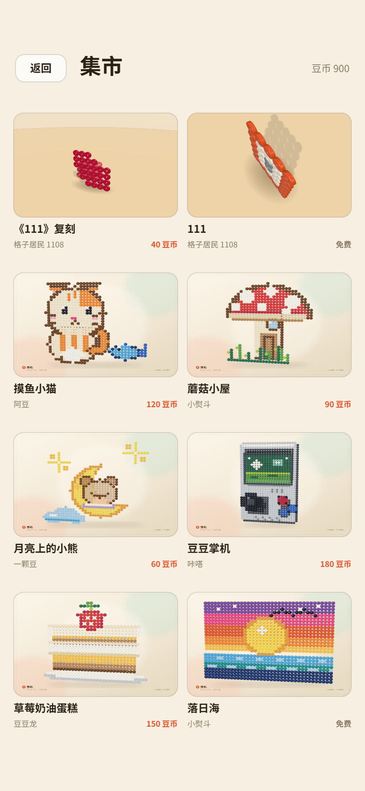
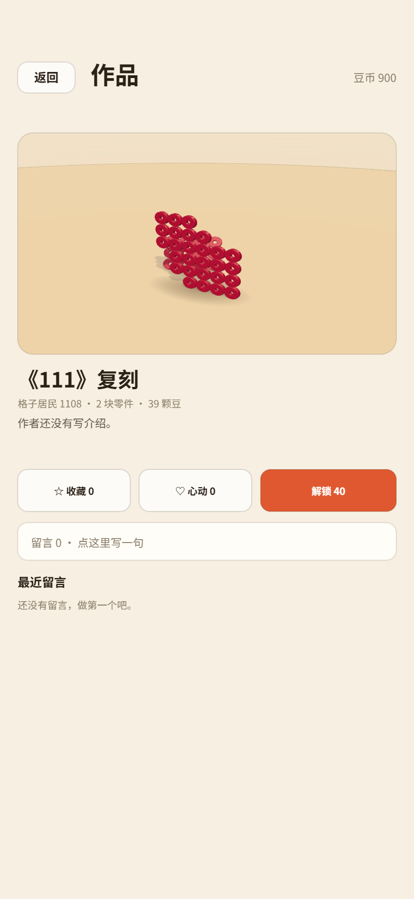
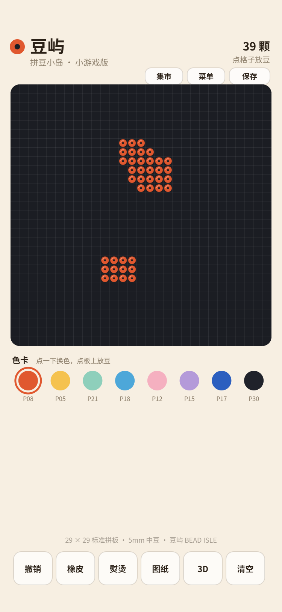
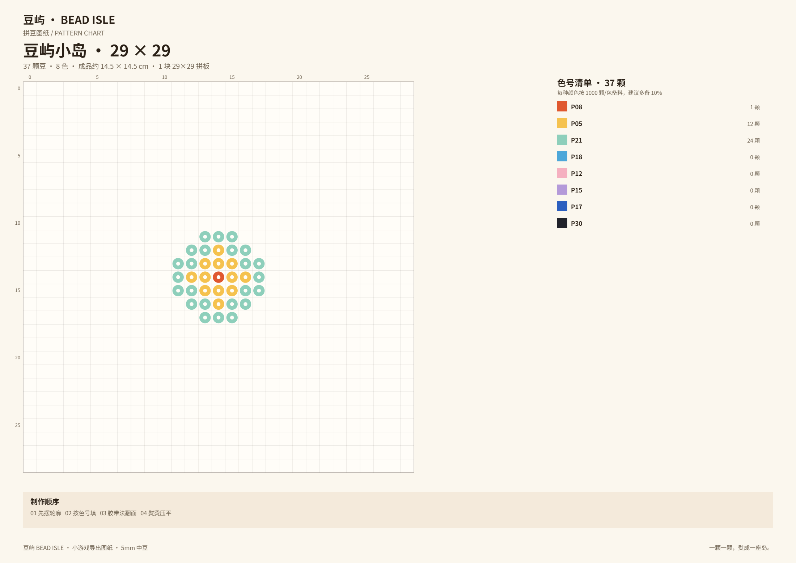
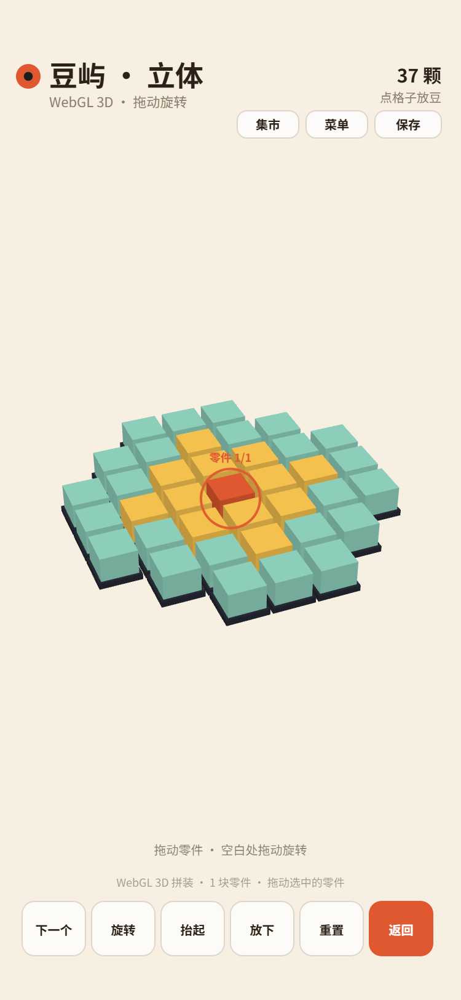

# 豆屿 · 拼豆小岛（微信小游戏版）

这是**微信小游戏**工程，不是小程序。

- 入口：`game.json` + `game.js`
- 运行：Canvas 2D
- 不使用 WXML / WXSS / web-view
- 项目类型必须是**小游戏**，AppID 也必须是**小游戏 AppID**

## 现在这版能做什么





| 菜单 | 豆仓 | 按行 |
| --- | --- | --- |
|  |  |  |

| 集市 | 作品详情 |
| --- | --- |
|  |  |







## 连服务端

集市和作品详情直接请求现有豆屿服务：

```js
const API_BASE = 'http://127.0.0.1:8787';
```

- 开发者工具模拟器：先 `npm start`，保持这个地址即可
- 手机/真机：改成电脑局域网 IP，例如 `http://192.168.1.23:8787`
- 正式上线：用 HTTPS 域名，并在公众平台配置 request 合法域名
- 需要先启动服务端；不启动时集市会提示网络没有连上

- 29×29 标准拼板
- 8 色色卡，点色块换色
- 点格子放豆，橡皮模式收豆
- 撤销、熨烫（把豆子变成熨过的效果）、清空
- 照片转图纸：从相册/拍照选图，按 29×29 自动配成 8 色
- 2.5D / WebGL 3D：有 WebGL 时用 WebGL 渲染，可上下左右拖动旋转；不支持时回退 2.5D
- 3D 零件拼装：自动按连通块拆零件，点选零件后可拖动、旋转、抬起、放下、重置、撤销
- 拖动松手吸附 0.5 格；重叠会回弹
- 菜单：豆仓 / 缺色、按行跟做、保存图片、导出 A4 图纸、分享
- 豆仓：按当前拼板统计用量，本地库存 +100，显示缺色
- 按行跟做：一次亮一行，上一行 / 下一行 / 退出
- 集市：拉取服务端作品列表，2 列卡片；支持「最新 / 我的收藏」筛选
- 作品详情：封面、作者、零件/颗数、收藏、心动、解锁、留言
- 解锁 / 收藏 / 心动 / 留言都接现有 `/api`
- 解锁后把 scene 缩放铺回 29×29 拼板，可以继续改
- 导出 A4 图纸：2200×1556 图纸，含色号、用量、坐标和制作顺序，保存到相册
- 菜单分享小游戏 / 保存当前画面到相册
- 本地自动保存
- 打开自带一小块示例岛，可以直接清空

## 这版还不是完整豆屿

小游戏不能用小程序那套 `web-view` 加载 H5，所以不能直接把 React 版塞进来。

当前是**重新写的 Canvas 核心版**，还缺：

- PDF 图纸（小游戏没有 DOM，不能直接跑 pdf.js；需要服务端转图）
- A4 分板打印（现在是导出 A4 图片到相册，不能直接调打印机）
- 3D 多层支撑 / 更精细的碰撞（现在只做同层格子重叠回弹）
- 多品牌色号搜索 / AI 抠图
- 用户主动登录

这些都还要在 Canvas / WebGL / `wx.request` 里逐步移植。

## 导入开发者工具

1. 打开微信开发者工具
2. 导入项目
3. 目录选择：

```text
E:\湖北\douyu\wechat-game
```

4. 项目类型选择 **小游戏**（不是小程序）
5. AppID 填你注册的**小游戏 AppID**
6. 编译后应该直接看到豆屿拼板

## 为什么不能直接用之前的 wechat-mini

`wechat-mini/` 是**小程序**工程：

- `app.json` + `pages/` + `web-view`

小游戏要求：

- `game.json` + `game.js` + Canvas

把小程序代码放到小游戏 AppID 下，就会报 `game.json: 未找到`。所以这里单独做了一套小游戏工程。

## 上手机

- 开发者工具里能跑后，点「上传」
- 到微信公众平台，把版本设为体验版
- 手机微信扫码，添加体验成员

## 下一步

如果要把完整豆屿做成小游戏，建议顺序：

1. 拼板 / 色卡 / 熨烫（已有）
2. 图纸模式（Canvas 画格子和色号）
3. 3D 用 WebGL / three.js 的小游戏适配
4. 集市和账号用 `wx.request` 接现有服务端
5. 照片转图纸用 Canvas 读像素，或调用服务端

> 真实上线需要 HTTPS 域名和业务域名配置；本地 `127.0.0.1` 只适合开发者工具。
